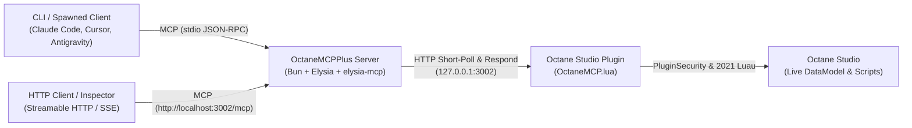

# OctaneMCPPlus ⚡

[](LICENSE)
[](https://bun.sh)
[](https://elysiajs.com)
[](https://luau-lang.org)
[](https://modelcontextprotocol.io)

A high-performance **Model Context Protocol (MCP)** server and Studio plugin specifically engineered for **Octane** (the 2021 Luau Roblox revival). Connect your favorite AI coding assistants (Antigravity, Claude Code, Cursor, Windsurf) directly to your Octane Studio session.

---

## Features

- **🚀 Real-Time Execution**: Evaluate Luau code on the fly in Studio edit mode with captured stdout/stderr and return values.
- **📝 Script Reading & Writing**: Inspect, create, and update `Script`, `LocalScript`, and `ModuleScript` sources directly inside the DataModel.
- **🌲 DataModel Inspection**: Explore the instance tree with configurable depth and class filtering.
- **✨ Instance Manipulation**: Create, configure, select, and destroy instances (`Part`, `Model`, `Folder`, `RemoteEvent`, etc.) with full property support (`Vector3`, `Color3`, `CFrame`, `Enums`).
- **⏪ Undo / Redo Safe**: Every modification automatically registers a checkpoint with `ChangeHistoryService`.
- **🌐 Dual MCP Transports**: Supports both standard **stdio** (Claude Code, Cursor, Antigravity) and **Streamable HTTP MCP** via [`elysia-mcp`](https://github.com/kerlos/elysia-mcp) at `/mcp` for web/remote clients and MCP Inspector.
- **⚡ Bun + Elysia Architecture**: Sub-millisecond response latency with zero socket-hanging heuristics or Roblox cURL timeout bugs.
- **🛡️ 2021 Engine Compatibility**: Built specifically for Octane's 2021 Luau build (no modern `task` library dependency; uses rock-solid native scheduler globals).

---

## Architecture



---

## Quick Setup

### 1. Prerequisites
- **[Bun](https://bun.sh)** (v1.0+)
- **Octane Studio** (2021 Luau client)

### 2. Install the Studio Plugin
1. Open Octane Studio.
2. In the top ribbon, open **Game Settings > Security** and set **Allow HTTP Requests** to **ON**.
3. Copy [`plugin/OctaneMCP.lua`](./plugin/OctaneMCP.lua) directly into your Octane plugins folder:
   - **Windows**: `%localappdata%\Octane\Plugins\OctaneMCP.lua`
   - *Alternatively, paste the script into a Script inside Studio, right-click, and select "Save as Local Plugin..."*.
4. You will see the **"Toggle MCP Bridge"** button appear in your Studio **Plugins** tab!

### 3. Clone & Run the Server
```bash
git clone https://github.com/OctaneUtils/OctaneMCPPlus.git
cd OctaneMCPPlus
bun install
bun start
```

---

## Connecting Your AI Client

Add the server to your AI client's MCP configuration:

### Claude Code (CLI)
Add OctaneMCPPlus directly using the Claude Code CLI:
```bash
claude mcp add octane -- bun run <PATH_TO_OCTANE_MCP_PLUS>/src/index.js
```
*Note: If you run `claude` inside the cloned `OctaneMCPPlus` repository, it will automatically detect and load the included `.mcp.json` configuration!*

### Claude Desktop

You can install OctaneMCPPlus in Claude Desktop using either the new **Desktop Extension (`.mcpb`)** or manual configuration:

#### Option A: Desktop Extension (`.mcpb` One-Click Install)
1. Build the standalone bundle:
   ```bash
   bun run pack
   ```
2. In Claude Desktop, open **Settings > Extensions > Advanced settings**.
3. Under **Extension Developer**, click **"Install Extension..."** and select `octane-mcp.mcpb`.
4. Claude Desktop will run the extension using its built-in runtime—no external terminal or configuration editing required!

#### Option B: Manual Config (`claude_desktop_config.json`)
```json
{
  "mcpServers": {
    "octane": {
      "command": "bun",
      "args": [
        "run",
        "<PATH_TO_OCTANE_MCP_PLUS>/src/index.js"
      ],
      "env": {
        "OCTANE_PORT": "3002"
      }
    }
  }
}
```

### Cursor (`~/.cursor/mcp.json` or Workspace Settings)
```json
{
  "mcpServers": {
    "octane": {
      "command": "bun",
      "args": [
        "run",
        "<PATH_TO_OCTANE_MCP_PLUS>/src/index.js"
      ]
    }
  }
}
```

### Antigravity
Configure inside your tool settings or active configuration:
```json
{
  "mcpServers": {
    "octane": {
      "command": "bun",
      "args": [
        "run",
        "<PATH_TO_OCTANE_MCP_PLUS>/src/index.js"
      ]
    }
  }
}
```

### HTTP Streamable MCP & Inspector (`elysia-mcp`)
OctaneMCPPlus exposes an HTTP Streamable MCP endpoint powered by [`elysia-mcp`](https://github.com/kerlos/elysia-mcp) at `http://localhost:3002/mcp`.

For remote or browser-based AI clients supporting HTTP MCP:
```json
{
  "mcpServers": {
    "octane": {
      "url": "http://localhost:3002/mcp"
    }
  }
}
```

To visually inspect and test tools using the official **MCP Inspector**:
```bash
# In terminal 1: Start the Octane MCP server
bun start

# In terminal 2: Launch MCP Inspector pointing to the elysia-mcp endpoint
npx @modelcontextprotocol/inspector http://localhost:3002/mcp
```

---

## Available MCP Tools

| Tool | Parameters | Description |
|---|---|---|
| `get_status` | *(none)* | Checks if Octane Studio is connected and reports heartbeat status. |
| `execute_luau` | `code: string` | Evaluates arbitrary Luau code in Studio edit mode, capturing print/warn logs and returning values. |
| `read_script` | `path: string` | Reads the `.Source` of any script by path (e.g. `ServerScriptService.GameManager`). |
| `write_script` | `path: string`, `source: string`, `className?: string` | Creates or updates scripts with new source code. |
| `get_tree` | `rootPath?: string`, `maxDepth?: number`, `classNameFilter?: string` | Inspects the DataModel hierarchy under any root (e.g. `Workspace`, `ReplicatedStorage`, or `game`). |
| `get_selection` | *(none)* | Returns instances currently selected in Explorer or 3D viewport. |
| `set_selection` | `paths: string[]` | Selects instances programmatically by path. |
| `create_instance` | `className: string`, `parentPath: string`, `name?: string`, `properties?: object` | Creates instances (`Part`, `Model`, `Folder`, `RemoteEvent`, etc.) with custom properties. |
| `delete_instance` | `path: string` | Destroys an instance at a target path. |
| `get_properties` | `path: string`, `properties: string[]` | Reads specified properties of an instance. |
| `set_properties` | `path: string`, `properties: object` | Updates properties of an instance (`Vector3`, `Color3`, `CFrame`, `Enums`). |

---

## Testing & Diagnostics

Test the bridge communication:
```bash
bun test
```

Check the real-time bridge connection status:
```bash
bun run status
```

---

## Troubleshooting

### "HttpService is not allowed to access ROBLOX resources"
This error is caused by Roblox Studio's internal cURL wrapper when a socket times out or closes unexpectedly. Octane MCP uses fast short-polling ($<1\text{ms}$) with a $0.5\text{s}$ pause to prevent this entirely. If seen, ensure you are running the latest version of [`plugin/OctaneMCP.lua`](./plugin/OctaneMCP.lua).

### "Http requests are not enabled"
You must enable outgoing HTTP requests in Octane Studio:
1. Open **Game Settings** (Home ribbon).
2. Go to **Security**.
3. Toggle **Allow HTTP Requests** to **ON** and save.

### "Octane does not have the task library"
Octane's Luau engine build does not include the modern `task` scheduler library (`task.wait`, `task.delay`). The Octane MCP plugin uses Roblox's native globals (`wait`, `spawn`, `delay`) to guarantee 100% compatibility.

---

## License

This project is licensed under the [MIT License](LICENSE).
